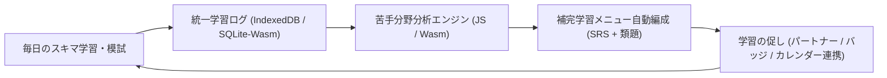

# 苦手分野の分析・補完学習管理・学習促進（ナッジ）設計提案

作成日: 2026-11-22  
対象プロジェクト: TOEIC L&R 模擬試験・学習アプリ（完全静的PWA / Cloudflare Pages）

---

## 1. 背景と現状の課題

現行アプリでは、ブラウザ内保存（`localStorage`）による学習履歴、技能別の正答率表示（3回答以上かつ正答率70%未満を抽出）、単語帳、学習パートナー（ひなた・蓮・ミロ）、およびリスニング模試100問が動作している。

一方で、学習者が「自分の弱点を正確に把握し、継続的に克服する」という観点では以下の課題がある。

1. **履歴の分断**: リスニング模試（`/listening/`）、分野学習、Part 5ミニ模試の結果が統一的に蓄積・分析されておらず、全体像が見えない。
2. **苦手判定の単純さ**: 全期間の単純合算（同一問題の再受験も含む）のため、「昔間違えたが今は解ける技能」と「直近で取りこぼしている技能」を区別できない。
3. **処方（次のアクション）の不足**: 「優先して復習する技能」は表示されるが、それを補完するための具体的な学習メニュー（何を・何問・どの順で解くか）や定着管理がない。
4. **継続を促す仕組みの弱さ**: 学習者自身が能動的にサイトを開かない限り学習が再開されず、再開時の心理的ハードルを下げる導線も限定的である。

本提案では、現行の**完全静的（サーバーレス）・ローカルファースト（アカウント不要・JSONバックアップ対応）**を堅持しつつ、**「毎日3〜10分のスキマ学習」をデフォルト導線**として、**「分析 → 補完学習の編成 → 学習の促し → 再検証」**の循環を作る仕組みを設計する。

---

## 2. 全体設計方針

- **完全静的（サーバーレス）の堅持**: バックエンドAPI、アカウント登録、サーバー側DB、およびCloudflare Workers等を含め、サーバーサイド処理は一切置かない。すべてのデータ保存・分析・学習管理をクライアント（ブラウザ）内で完結させ、既存のJSONエクスポート／インポートの拡張で端末間移行を支える。
- **WebAssembly（Wasm）の活用可**: 高度な統計分析やローカルDB処理が必要になった場合は、サーバーに頼らず静的アセットとして配信できる Wasm（例：Rust製分析エンジン、SQLite-Wasm 等）をクライアント内で活用する。
- **毎日3〜10分のスキマ学習をデフォルト**: 「まとまった時間がないと始められない」を防ぎ、アプリを開いてすぐ3分（2〜3問）または10分（5〜6問）の補完学習に着手できる設計を主軸とする。模試は週末や節目での実力確認・弱点棚卸しとして位置づける。
- **公式スコア換算の非採用**: `AGENTS.md` の方針に従い、予測スコアの提示は行わず、Part別・技能別の正答率、定着度、克服ステータスで進捗を可視化する。

---

## 3. 柱1：苦手分野の分析モデル

### 3.1 データの統合記録
全Part（Part 1〜7）の模試・分野学習・診断・単語帳の解答イベントを統一フォーマットで記録する。

- 記録項目: `examId`, `revision`, `itemId`, `part`, `skill`, `difficulty` (`easy`/`medium`/`hard`), `isCorrect`, `selectedChoiceId`, `answeredAt`, `timeSpentMs`, `mode` (`exam`/`study`/`review`)

### 3.2 多軸による「苦手度」の算出
単純な通算正答率ではなく、以下の4要素を組み合わせて技能ごとの**優先度スコア**を算出する。

| 評価軸 | 内容 | 狙い |
|---|---|---|
| **直近重視（時間減衰）** | 直近5〜10問の結果に高い重みを置く | 過去の誤答に引っ張られず、現在の弱点を反映する |
| **初見 vs 再挑戦の分離** | 同一 `itemId` の初見正答率と再挑戦正答率を分けて管理 | 同じ問題の丸暗記による見かけ上の克服を防ぐ |
| **難易度補正** | `easy` での誤答を `hard` より重く評価 | 基礎の取りこぼしを最優先で拾い上げる |
| **解答時間（Part 5–7）** | 正解でも目安時間を大きく超過した問題を「不安定」として記録 | リーディングの時間切れ要因（処理速度不足）を可視化する |

### 3.3 ステータス分類と可視化
回答数が少ない段階での誤判定を防ぐため、技能ごとに状態を明示する。

- **未計測**: 初見回答が3問未満
- **要強化（苦手確定）**: 直近正答率70%未満、または `easy` での誤答が複数
- **復習中**: 補完学習に着手し改善傾向にあるが、類題での定着確認が未完了
- **定着済み**: 直近正答率80%以上かつ初見・類題でも安定して正解

UI上では「なぜこの技能が優先なのか」を1行の根拠として表示する（例：`直近5問で2/5正解・基礎問題での取りこぼしあり`）。

---

## 4. 柱2：苦手分野を補完する学習管理

### 4.1 「今日のスキマ学習メニュー」の自動編成（デフォルト：3分 / 10分）
学習者がアプリを開いた瞬間に、分析結果から最適なミニセットを自動提示する。

- **3分コース（デフォルト・超短時間）**: 復習キューの誤答問題 2問 ＋ 関連単語 3語
- **10分コース（標準スキマ学習）**: 最優先の苦手技能ドリル 4問 ＋ 復習キュー 2問 ＋ 単語確認
- **しっかり学習（任意選択）**: リスニングまたはリーディングの苦手Partセット／模試

### 4.2 間隔反復（SRS）による復習キュー管理
間違えた問題や単語帳の未習得語を、忘却曲線に沿った間隔で自動的に復習キューへ戻す。

- 基本間隔の例: **1日後 → 3日後 → 7日後 → 21日後**
- 復習で正解すれば次の間隔へ進み、不正解なら1日後にリセットする。
- **卒業判定（丸暗記の防止）**: 同じ問題に正解しただけでは「定着済み」にせず、同 `skill` の**未解答問題（類題）**で正解して初めて苦手ステータスを解除する。

### 4.3 目標と進捗の管理
- **毎日のスキマ学習目標**: デフォルトは「1日1セッション（3分〜）」または「週5日」とし、学習者が自分のペースに合わせて変更可能にする。
- **苦手克服リスト**: 技能ごとのステータス遷移（要強化 → 復習中 → 定着済み）を一覧表示し、克服した技能を「達成済み」として残すことで自己効力感を高める。

---

## 5. 柱3：人に学習を促す仕組み（ナッジ設計）

完全静的（サーバーレス）なPWAの前提のもと、**アプリ内（開いたとき）**と**アプリ外（開く前）**の2層で継続を促す。

### 5.1 アプリ内の促し
1. **ワンタップ開始（「迷わせない」ホーム画面）**
   - トップ画面の最上部に「今日の3分メニュー（例：接続詞と前置詞・2問＋単語3語）」と開始ボタンを配置し、開いて1タップで学習に入れるようにする。
2. **学習パートナー（ひなた・蓮・ミロ）の文脈連動**
   - 従来の「採点時の反応」に加え、以下の状況に応じた声かけを行う。
     - 復習期限の到来時：「前に間違えた『動詞の形』、今日が復習のタイミングだよ。3分だけやってみる？」
     - ブランク後の復帰時：「おかえり！久しぶりだから、まずは1問だけのウォームアップから始めよう」
     - 苦手克服時：「『接続詞と前置詞』が定着済みになったね！次は『語彙と文脈』を少し見てみようか」
3. **途切れにくい継続指標**
   - 毎日連続（ストリーク）だけでなく、**週間目標の達成（例：今週 3/5日 達成）**を併用し、1日休んでもモチベーションが折れにくい設計にする。

### 5.2 アプリ外からの促し（完全静的・サーバー不要）
サーバーからのWeb Pushに依存せず、OS・ブラウザの標準機能と外部カレンダーを組み合わせてリマインドを実現する。

- **PWAホーム画面追加の案内**: 初回診断完了後など価値を感じたタイミングでインストールを案内し、毎日の視界に入りやすくする。
- **PWAショートカット（`manifest.webmanifest`）**: アプリアイコン長押しから「今日の3分復習」へ直接ジャンプできるショートカットを定義する。
- **Badging API（アプリアイコンバッジ）**: 対応端末では、復習期限が来た問題・単語の件数をPWAアイコンのバッジに表示する。
- **カレンダー連携（`.ics` 書き出し）**: 「毎日 20:00 に5分学習」のような繰り返し予定（およびアプリURL）を `.ics` ファイルとしてクライアント内で生成し、学習者自身のスマホカレンダーの通知機能で確実にリマインドを受け取れるようにする。

---

## 6. データ設計と WebAssembly（Wasm）の活用方針

### 6.1 データストア構成（IndexedDB / JSONバックアップ拡張）
将来的な200問フル模試対応（`README.md` 記載）と合わせ、`localStorage` から `IndexedDB` へ移行する際のストア構成案を示す。

- `attempts`: 受験・分野学習ごとのセッション記録（既存履歴と互換）
- `itemLogs`: 問題単位の解答ログ（`itemId`, `part`, `skill`, `difficulty`, `isCorrect`, `timeSpentMs`, `answeredAt`）
- `reviewQueue`: SRS管理テーブル（`targetType`: `item`/`vocab`, `targetId`, `nextReviewAt`, `intervalDays`, `streak`）
- `preferences`: パートナー設定、学習目標（デフォルト：毎日3〜10分）、リマインド設定

既存のJSONエクスポート／インポートは `version: 2` として上記ストアを包含し、`version: 1` の旧バックアップもそのまま読み込める後方互換性を維持する。

### 6.2 WebAssembly（Wasm）の適用ポイント
Phase 1は軽量なJavaScriptで迅速に立ち上げ、履歴データや分析の高度化に合わせて以下の領域で Wasm を静的アセットとして導入できる。

- **高度分析・SRSスケジューラ（Rust → Wasm）**:
  - ベイズ知識追跡（BKT）やFSRS（Free Spaced Repetition Scheduler）等の計算、複数条件での最適メニュー編成を型安全かつ高速にクライアント内で実行する。
- **ローカル分析DB（SQLite-Wasm + OPFS）**:
  - 複数回の200問模試履歴が蓄積された際に、Part別×技能別×難易度別×解答時間のクロス集計をSQLで高速かつ簡潔に処理する。

---

## 7. 段階的実装ロードマップ（すべて完全静的）

| フェーズ | スコープ | 主な実装内容 |
|---|---|---|
| **Phase 1 (MVP)** | 履歴統合と基本処方 | ・Listening模試と分野学習の履歴を `IndexedDB` に統一保存 ・直近重視＋初見区別の苦手分析 ・ホーム画面の「今日の3分／10分メニュー」1タップ開始 ・パートナーの文脈別メッセージ |
| **Phase 2 (定着管理)** | SRSと習慣化支援 | ・誤答問題・単語のSRS復習キュー ・類題による苦手克服（卒業）判定 ・週間目標トラッカー ・`.ics` カレンダー書き出し / Badging API / PWAショートカット |
| **Phase 3 (高度分析・Wasm)** | クライアント内高度化 | ・Wasm（FSRS / BKT または SQLite-Wasm）による定着度推定・高速集計 ・Part 5–7 の解答時間分析（時間超過アラート） ・誤答選択肢の傾向分析（ひっかけパターンの可視化） |

---

## 8. 次のステップ・確認したい論点

完全静的（サーバーレス）の堅持・Wasm活用可・毎日3〜10分のスキマ学習デフォルトの方針を前提に、実装へ進む前に残る確認事項は以下の1点。

- **問題データとの連携順序**: 苦手分野の「類題による卒業判定」を機能させるには、各技能あたり複数問のプールが必要になる。現在初稿がある `content/mock-01`（Part 5–7）や `study-src` のアプリ組み込みを、Phase 1と同時期に進めるか、先にPhase 1の仕組みを既存データ上で構築するか。
